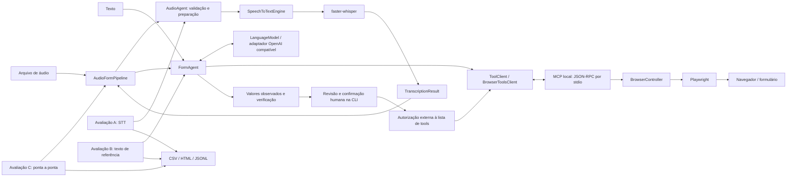

# Arquitetura e protocolo experimental

## Fluxo atual

AudioAgent continua independente, síncrono e utilizável por sua CLI. A composição usa
`asyncio.to_thread` para não bloquear o loop durante STT; não introduz uma API ou serviço.
O cancelamento da coroutine não interrompe à força uma inferência já iniciada na thread.
As avaliações são sequenciais e compartilham somente a instância do motor STT (cache de modelo).
Cada tentativa com formulário recebe Application, processo MCP e navegador novos.

A preparação atual valida o arquivo, sem denoising, resampling ou correção de transcrição.
Decodificação pertence ao adaptador faster-whisper. Preservar o texto bruto é necessário
para medir WER; correções humanas, se usadas, devem ser uma condição experimental separada.

## Agência e nomenclatura

Wooldridge e Jennings descrevem autonomia, reatividade, iniciativa orientada a objetivos
e habilidade social como propriedades da noção fraca de agência. O artigo também discute
softbots que observam e atuam em ambientes de software. [Fonte primária, 1995](https://www.cs.ox.ac.uk/people/michael.wooldridge/pubs/ker95/subsubsectionstar3_1_1_1.html).

Aplicação conceitual ao código, não classificação estabelecida pelos autores: FormAgent
possui um ciclo percepção–decisão–ação, com escolhas de ferramentas pelo modelo e feedback
do navegador. É defensável descrevê-lo como agente baseado em LLM com autonomia limitada
por permissões e orçamento de turnos. Não demonstra cooperação social entre agentes.
AudioAgent executa etapas predeterminadas e não escolhe metas ou ações sobre o ambiente;
é mais precisamente um componente/pipeline STT. A composição acrescenta encadeamento,
não negociação, coordenação autônoma ou um segundo decisor. Portanto, o código não fornece
base forte para afirmar um sistema multiagente no sentido dessa literatura. Classes,
comandos e nome de projeto foram preservados; recomenda-se explicar essa distinção no TCC.

## Autorização e confirmação

- `FormAgent.run(..., authorize_submission=False)` bloqueia envio por padrão. A instrução,
  o inventário, a saída do modelo e a transcrição nunca concedem essa permissão.
- O núcleo aceita apenas quatro nomes fixos, intersectados com as tools anunciadas.
  `click_button` não é oferecida ao modelo sem autorização; pedidos forjados também são bloqueados.
- BrowserController tem uma segunda trava, inicialmente falsa. Somente o host pode habilitá-la
  pelo método MCP local `form-agent/authorize-submission`, ausente de `tools/list` e de `tools/call`.
  Acrescentar `authorized=true` aos argumentos de uma tool é rejeitado.
- A negação textual continua como veto conservador. Não é um interpretador completo de português:
  “não altere a cidade e envie” pode ser excessivamente bloqueado. Expressões condicionais,
  citações, ironia e erros de STT não são fontes confiáveis de autorização.
- A CLI de texto preenche, exibe valores e, quando detecta uma sugestão textual de envio,
  exige digitar `ENVIAR`. A CLI de voz só oferece essa etapa com `--confirm-submit`.
  A comparação do snapshot revisado com uma nova inspeção impede enviar valores que mudaram
  desde a revisão. Sem confirmação, o resultado permanece no navegador durante a sessão de texto.
- Avaliação automatizada usa `--allow-submission` **e** `submission_authorized=true` no caso.
  `submitted` é o oráculo esperado; não concede permissão. A autorização vale somente para
  aquele caso e não é inferida da transcrição. Experimentos não usam confirmação interativa.
- Só se autorizam botões nativos `type=submit`; botões arbitrários, reset e widgets customizados
  ficam bloqueados. Antes do clique verificam-se os valores escritos e a validade nativa do formulário.
- Uma tentativa consome a permissão. Falha/timeout de envio não é repetida automaticamente.

`submitted=true` significa que o seletor de sucesso configurado ficou visível após a tentativa.
O padrão é `[data-form-agent-submitted="true"]`, produzido pelos exemplos locais. Um indicador
já visível antes do clique não serve de evidência nova. Em outro formulário, configure
`SUBMISSION_SUCCESS_SELECTOR` e valide o oráculo; ele não prova persistência em um backend.
O evento nativo `submit` tampouco prova isso, e nem ocorre quando a validação HTML bloqueia
uma submissão. [MDN, semântica do evento](https://developer.mozilla.org/en-US/docs/Web/API/HTMLFormElement/submit_event).

A garantia estrutural cobre **as ações expostas ao LLM pelo host confiável**, não uma página
arbitrária hostil: JavaScript da página pode enviar dados em eventos de `input`/`change`, fazer
requisições em segundo plano ou falsificar um indicador de sucesso. Esta PoC deve usar formulários
controlados; não constitui sandbox de rede nem verificador de intenções de scripts externos.

## Estado do formulário e automação

`inspect_form` contém valores, validade HTML e mensagens, além do inventário anterior.
AgentResult conserva snapshots inicial e final (antes de enviar, se houver navegação).
A mesma inspeção atende modelo, verificação e avaliação; não há `get_form_state` duplicado.
O agente relê todos os campos escritos ao terminar e antes de enviar, mesmo se o LLM já leu.
Leitura que falha ou diverge do último valor observado gera `VERIFICATION_ERROR`.

Controles hidden e invisíveis não entram no inventário operacional. Campos disabled/readonly
são descritos mas não podem ser preenchidos. A busca suporta labels, name, id, placeholder,
aria-label e aria-labelledby simples. IDs/nomes únicos distinguem rótulos repetidos; ausência
de identidade única impede avaliação conclusiva. Correspondência parcial tem comprimento
mínimo de três caracteres e procura o termo dentro do identificador, sem aceitar uma letra
contida arbitrariamente na instrução. Empates continuam sendo erros.

Os locators do Playwright relocalizam elementos quando usados, o que favorece re-renderizações,
e há locators específicos para placeholder e labels. Isso não equivale a suporte universal a
componentes customizados. [Documentação oficial](https://playwright.dev/python/docs/locators).

Prioridades de browser: controles nativos dinâmicos, acessibilidade básica, máscaras e
validação HTML têm alto retorno experimental e estão cobertos localmente. Selects customizados,
autocomplete assíncrono, combobox ARIA sem controle nativo e validação JS sem indicador
exigem fixtures e contratos próprios. Iframes não são inspecionados. Shadow DOM aberto pode
ser atravessado pelos locators CSS/label, mas precisa de experimento específico; fechado
permanece fora do escopo. React/Vue/Angular não são incompatíveis por nome: o que importa
é a semântica DOM, a hidratação e os eventos. Nenhum deles foi instalado para simular suporte.

## Três níveis de avaliação

| Modo | Entrada efetiva do FormAgent | O que mede | O que não conclui |
|---|---|---|---|
| A `stt` | Não executa FormAgent | WER/CER, processamento, RTF, falhas STT | Qualidade de preenchimento |
| B `reference` / avaliação textual | Texto humano de referência | Campos, efeitos extras, envio, F1, estabilidade, latência | Robustez ao reconhecimento de fala |
| C `pipeline` | Transcrição bruta | STT + resultado funcional integrado | Causa definitiva de cada erro sem análise complementar |

B e C podem usar o mesmo `case_id` do catálogo de áudio, permitindo pareamento por caso,
configuração e tentativa. Não há paralelismo entre tentativas, nem cache de respostas do LLM.
No modo A, PASS significa que o motor retornou uma transcrição estruturada; não significa WER
zero nem inteligibilidade. Transcrição vazia pode ser correta em um caso de silêncio. No modo C,
texto vazio termina com `STT_EMPTY`, sem chamar o FormAgent. Falhas STT não recebem WER inventado.

## Definições das métricas

**Normalização STT `nfc-casefold-whitespace-v1`:** Unicode NFC, casefold, remoção de espaços
externos e compressão de sequências de espaços. Mantém acentos e pontuação, relevantes para
nomes, e-mails e números. CER inclui espaços normalizados. Não comparar resultados obtidos
com normalizações diferentes como se fossem a mesma métrica.

WER = distância de edição entre palavras / número de palavras da referência. A distância
mínima conta substituições, inserções e exclusões com custo um. CER aplica a mesma definição
a caracteres. WER pode exceder 1. Referência vazia produz WER/CER nulos; as contagens de edição
continuam registradas para estudar alucinação em silêncio. A definição de WER e a importância
de declarar antecipadamente o protocolo de avaliação são discutidas no [NIST Evaluation Cookbook](https://tsapps.nist.gov/publication/get_pdf.cfm?pub_id=150472).

A agregação é micro: soma das edições / soma dos tamanhos de referências não vazias.
Relatórios mostram número de tentativas transcritas, pontuadas e referências vazias. Falhas
operacionais ficam fora do denominador WER, mas dentro do denominador de sucesso funcional C.
Essa diferença precisa aparecer na redação dos resultados, para evitar viés de sobrevivência.

RTF = tempo de processamento STT / duração do áudio, quando duração > 0. O tempo STT inclui
preparação, carregamento na primeira chamada, inferência e consumo dos segmentos; não é uma
medida isolada de GPU. O total da tentativa inclui composição e chamadas MCP, mas exclui
construção de manifesto/relatório e encerramento de recursos. `form_seconds` mede a execução
FormAgent, incluindo a abertura do navegador na primeira inspeção. Relate primeira chamada
separadamente e mantenha hardware, modelo e condições de cache registrados.

**Sucesso funcional:** todos os campos esperados existem com valores corretos; nenhuma escrita
explícita extra ou alteração adicional observada ocorre; os campos avaliados são válidos;
o estado final é verificável; o limite de turnos não é atingido; e a submissão respeita o oráculo.
Se envio não era esperado, uma tentativa sem confirmação também é falha. Se era esperado,
é necessária confirmação observável e autorização externa. Taxa = execuções bem-sucedidas /
execuções totais desse modo. O pass rate ainda exige também acertar a expectativa `unmatched`.

Campos pré-preenchidos corretos contam como resultado funcional sem exigir reescrita.
Valores extras inalterados são preservados. Escritas explícitas em campos não esperados são
penalizadas conservadoramente, mesmo se posteriormente restauradas. Snapshots capturam
alterações finais indiretas em controles nativos visíveis; não observam cada mutação transitória
nem dados internos/hidden/iframes. Esta é uma definição operacional, não uma prova sobre todo o DOM.

A comparação funcional é exata e sensível a caixa/acentos/tipo: strings para inputs/select,
booleanos para checkbox/radio. Esta decisão é mais rigorosa que o casefold da avaliação
original e é uma mudança metodológica; não juntar os resultados antigos e novos sem reavaliar.
O select pode receber a transcrição “Ceara” e produzir valor DOM `CE`, idêntico ao oráculo.

**Sucesso parcial:** precision/recall/F1 por pares campo–valor, preservando microagregação
existente. Um valor incorreto contribui para previsão incorreta e valor esperado não encontrado;
um campo ausente reduz recall; uma escrita extra reduz precision. Predições são valores
observados não vazios, valores vazios/false explicitamente esperados e escritas extras.
Denominador vazio usa 1 como na base; leia essas métricas junto do sucesso funcional e das falhas.
Sem definição adicional de dezenas de scores.

Estabilidade = fração de casos em que **todas** as tentativas passam. Não é variância de texto,
consistência de raciocínio nem intervalo de confiança. Latência média e P95 usam tentativas
concluídas, incluindo falhas. P95 usa nearest rank; amostras pequenas não suportam inferências
finas sobre caudas. A tabela de quatro combinações WER zero/positivo × sucesso/falha funcional
mostra diretamente quando uma diferença linguística é tolerada.

## Proveniência, sem atribuição causal automática

| Código observado | Significado |
|---|---|
| INPUT_ERROR | Referência vazia no modo B (não aciona FormAgent) |
| STT_ERROR / STT_EMPTY | Falha de preparação/inferência; ou ausência de texto no pipeline |
| PROVIDER_ERROR | Autenticação, conexão, timeout do provider ou resposta LLM inutilizável |
| FIELD_NOT_FOUND / FIELD_AMBIGUOUS | Resolução de campo/opção sem correspondência ou com empate |
| TOOL_ERROR | Tool desconhecida, contrato inválido ou falha de transporte não mais específica |
| TIMEOUT / BROWSER_ERROR | Timeout MCP/automação ou falha do navegador |
| VERIFICATION_ERROR / VALIDATION_ERROR | Estado não confirmado, divergência ou validade nativa falsa |
| SUBMISSION_BLOCKED / SUBMISSION_ERROR | Política bloqueou ação; ou envio esperado/tentado sem confirmação |
| MAX_TURNS | Ciclo terminou pelo orçamento |
| OUTCOME_MISMATCH | Oráculo e estado divergem, sem causa específica demonstrada |
| INTERNAL_ERROR | Exceção inesperada na fronteira do executor, retida como falha da tentativa |

`error_codes` são ocorrências, inclusive falhas recuperadas; não equivalem automaticamente a
causas-raiz e não são categorias mutuamente exclusivas. Um bloqueio correto pode coexistir com
sucesso funcional. O rastreamento mantém estágio, ferramenta, argumentos, saídas e eventos.
O relatório contém `run_id` e `trace_path`, permitindo revisão posterior.

Para atribuir STT, mapeamento semântico ou identificação incorreta, compare B/C pareados,
inspecione transcrição, primeira tool incorreta e estado observado. Se B passa e C falha,
existe evidência compatível com propagação de erro do STT, não prova causal, devido à
variabilidade do LLM. Faça reexecuções controladas e revisão humana. Use o catálogo
`failure-review.example.csv` para uma causa principal revisada, evidência e observação.
Publique denominador, regras de adjudicação e casos inconclusivos antes de calcular percentuais.

## Eventos e manifesto

`reports/runs/<run_id>.jsonl` armazena eventos ordenados com schema_version, run_id, sequence,
timestamp UTC, elapsed_seconds e data. Há eventos de áudio, inspeção, solicitação ao modelo,
chamadas/conclusões de tools, verificação e conclusão. Logs textuais continuam úteis para
operação; o JSONL contém os dados experimentais. Não há collector, banco ou serviço novo.

O primeiro evento contém commit Git, indicação de árvore suja, hash das fontes, Python,
plataforma, arquitetura, versões instaladas, provider/modelo, temperatura ou indicação de
padrão do provider, timeout, retries, max_turns, versão/hash do prompt, configurações STT,
caminho/hash de áudio e CSV e URL/hash de formulário local. Segmentos e demais metadados STT
ficam no evento de transcrição. Não se serializa ModelConfig inteiro nem variáveis de ambiente.
A chave da API é omitida e excluída do repr da configuração.

Os prompts v1/v2 são recursos empacotados. V1 preserva o texto original; a política estrutural
continua nova mesmo ao selecionar v1, portanto isso compara prompts sob a mesma política,
não reproduz integralmente o código antigo. `FORM_PROMPT_VERSION` identifica a condição.
`LLM_TEMPERATURE` é opcional; omitir evita enviar parâmetros não suportados pelo perfil.
Retries do SDK são explicitamente zero, evitando tentativas ocultas no tempo medido.

Commit + dirty flag não reconstrói alterações locais. Preserve uma cópia/commit da versão
usada, manifesto, dependências, formulários e áudios autorizados. Hash identifica artefato,
não o recupera. Modelos remotos mutáveis, pesos baixados por nome, drivers, CPU/GPU e
nondeterminismo limitam replicação bit a bit. Não foi criado um gerenciador de ambientes;
use um venv e arquive `pip freeze` com cada rodada. Não comparar provedores mudando ao mesmo
tempo prompt, temperatura, formulário e dataset.

O transporte manual permanece isolado. Stdio usa JSON-RPC delimitado por linhas, compatível
com a opção descrita na [especificação MCP 2025-11-25](https://modelcontextprotocol.io/specification/2025-11-25/basic/transports).
A PoC não implementa todas as funcionalidades MCP: é um par cliente/servidor local, com versão
fixa, quatro tools e extensão privada de autorização. Há drenagem de stderr, validação de
versão/envelope/argumentos, serialização por lock e invalidação após resultado incerto. Não há
retry automático de tools. Migrar para SDK só vale a pena se um teste reproduzível mostrar
benefício ou se uma funcionalidade MCP adicional se tornar necessária ao TCC.

## Próximos experimentos e validade

Hipóteses agora testáveis: (H1) WER positivo nem sempre implica falha funcional; (H2) entidades
como e-mails/telefones são mais sensíveis que acentos em cidades; (H3) correções explícitas
melhoram o oráculo final, mas podem degradar STT; (H4) prompt v2 reduz escritas extras/ambiguidades;
(H5) VAD/modelo STT alteram o compromisso entre latência e sucesso funcional; (H6) autorização
externa mantém bloqueio mesmo diante de pedidos indevidos do LLM ou transcrição sem “não”.

1. Grave e revise um piloto pequeno, sem dados reais nos enunciados; confira oráculos antes de rodar.
2. Execute A, B e C com a mesma versão, exemplos locais e permissões explícitas; retenha todos os failures.
3. Separe primeira carga de chamadas seguintes e repita B/C; faça comparação pareada por caso/falante.
4. Varie um fator de cada vez (modelo STT, VAD, provider ou prompt), após fixar a linha de base.
5. Revise falhas com evidências e reporte inconclusivos; depois amplie um tipo de formulário por rodada.

**Validade interna:** controle ordem, cache, estado inicial, rede, limites/retries, versões,
normalização e possíveis diferenças na intenção de submissão. Tentativas do mesmo caso/falante
não são independentes. Não descarte casos por falhar nem atribua causas somente por WER.

**Validade externa:** corpus pequeno e lido, poucos falantes/regiões, dispositivo único,
formulários controlados, sem iframes/widgets genéricos e sem sessões autenticadas. Áudio sintético
pode servir para smoke tests, mas não substitui fala humana nem sustenta alegações sobre sotaques.

**Validade de construção:** WER/CER não medem preservação de entidades ou compreensão;
sucesso funcional depende do oráculo e do conjunto de controles observáveis. Indicador de envio
é um proxy de aceite da aplicação. Precisão não mede segurança sozinha. Nomenclatura multiagente
não deve ser tratada como variável comprovada pela quantidade de módulos.

**Limitações metodológicas:** sem resultados empíricos reais nesta implementação; os testes de
fluxo usam STT/LLM simulados. Ainda faltam gravações, protocolo institucional de coleta,
revisão independente das referências e oráculos, avaliação com provedores reais e incerteza
estatística por falante/caso. Nenhum percentual de desempenho humano foi inferido dos testes.
